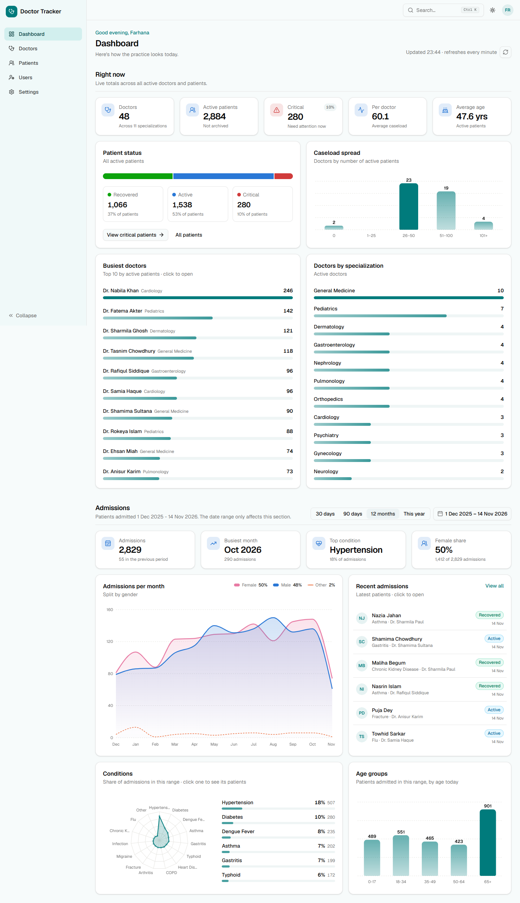
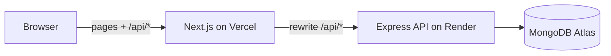
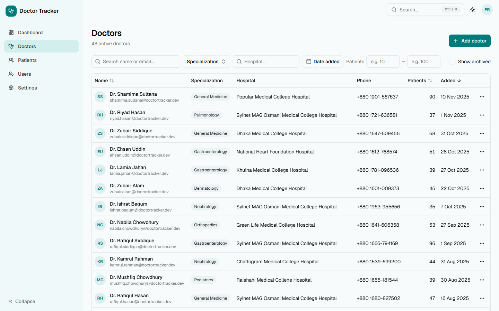
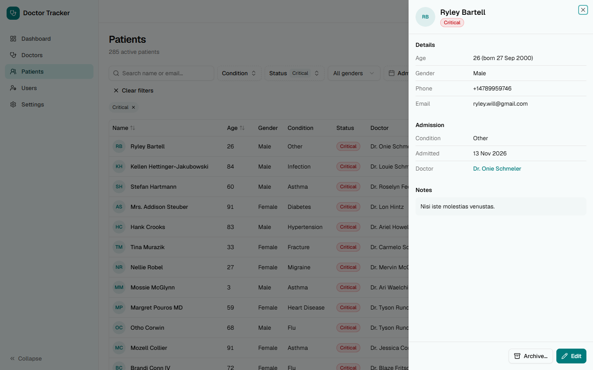
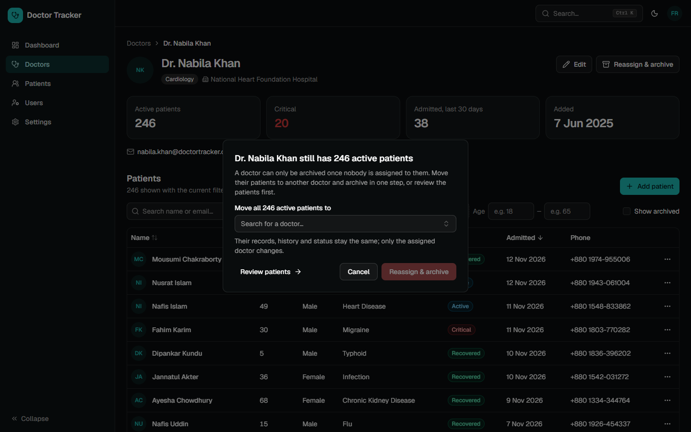
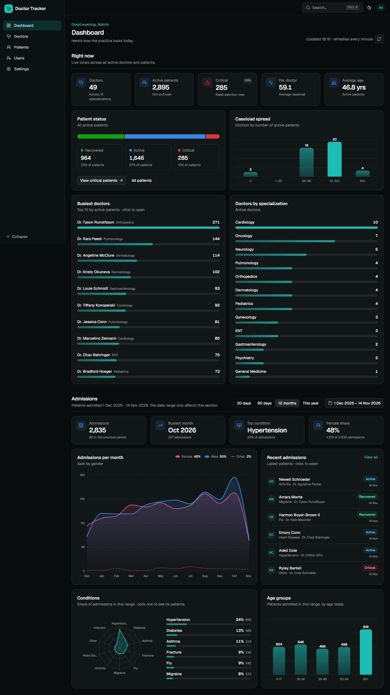
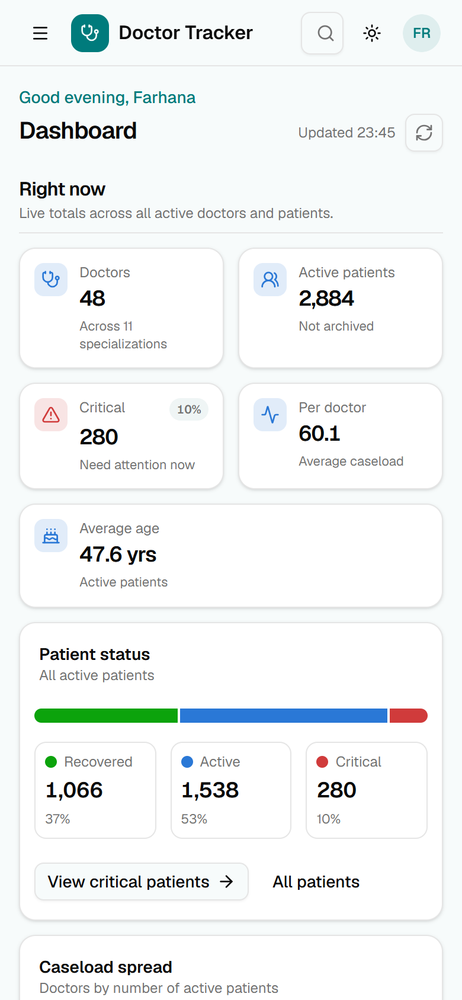
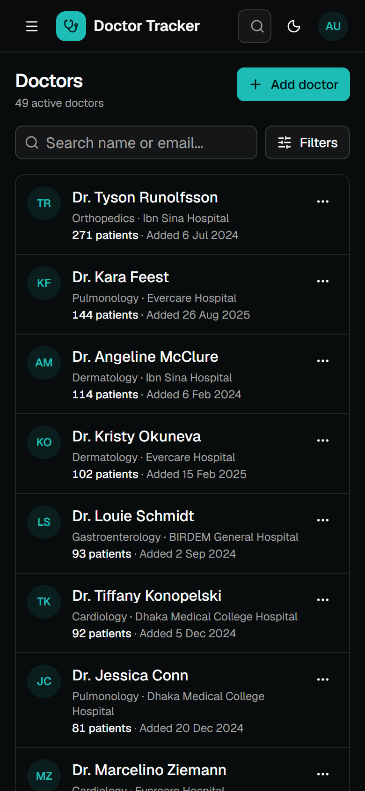
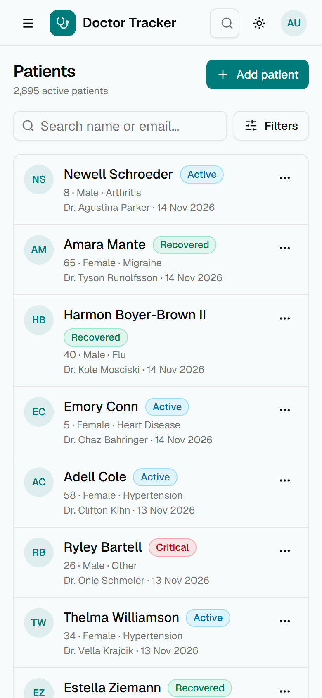

# Doctor Tracker

A clinic app for tracking doctors, their patients and admissions. Staff search and filter patients,
admit them and move them between doctors; admins also manage doctors, users and lookup lists. A
dashboard shows live totals and admission trends. Records are archived, never deleted, so patient
history stays recoverable.

This is the web client (Next.js). The API is
[doctor-tracker-server](https://github.com/iammahir2020/doctor-tracker-server).



## Links

- App: https://doctor-tracker-client-sage.vercel.app
- API health: https://doctor-tracker-server-50kq.onrender.com/api/health
- Demo accounts (admin and staff) are provided separately.

The API is on Render's free tier: the first request after ~15 idle minutes can take up to a minute
(the login page shows a "waking up" notice).

## Setup

Requires Node 24 (`nvm use` reads `.nvmrc`) and Docker.

1. Clone both repositories:
   ```bash
   git clone https://github.com/iammahir2020/doctor-tracker-server.git
   git clone https://github.com/iammahir2020/doctor-tracker-client.git
   ```
2. Start the API (in `doctor-tracker-server`):
   ```bash
   cp .env.example .env    # works as-is with the local database
   docker compose up -d    # MongoDB 8 as a single-node replica set
   npm install
   npm run seed            # admin + staff users, 50 doctors, 3,000 patients
   npm run dev             # http://localhost:4000
   ```
3. Start the client (in `doctor-tracker-client`):
   ```bash
   cp .env.example .env.local   # API_URL=http://localhost:4000
   npm install
   npm run dev                  # http://localhost:3000
   ```
4. Sign in with the admin or staff account from `SEED_*` in the server's `.env`.

Each repo has an `.env.example` listing every variable. Server tests: `npm test`.

## Architecture



- **Sign-in:** the browser posts to `/api/auth/login` on the Vercel domain; Next.js rewrites it to
  the API, which checks the password and sets a session cookie. `proxy.ts` sends anyone without the
  cookie to `/login`.
- **Lists:** filters, sort and page live in the URL. Changing one changes the TanStack Query key, which
  fetches `/api/doctors?...`; the API runs one indexed query plus a count and returns a page.
- **Changes:** an edit or archive updates the screen straight away, calls the API (patient writes and
  the doctor's patient count change in one MongoDB transaction), rolls back if the API refuses, and
  refreshes the affected lists and the dashboard.
- **Dashboard:** `/api/stats` runs two MongoDB aggregations in parallel, caches the result for 60 s
  (cleared on any write), and the page refreshes every minute.

## Technical decisions

### 1. Auth: httpOnly cookie behind a same-origin proxy

- **Problem:** the client (Vercel) and the API (Render) are on different domains, and the session
  token must not be readable by page scripts.
- **Choice:** the API sets the JWT in an httpOnly, Secure, SameSite=Lax cookie, and Next.js
  rewrites `/api/*` to the API, so the browser only ever talks to the Vercel domain.
- **Why:** a token in localStorage can be stolen by any XSS bug; an httpOnly cookie can't be read by
  JavaScript. Calling the API domain directly would make it a third-party cookie (blocked by Safari
  and increasingly Chrome, needs `SameSite=None` and CORS preflights). Through the rewrite it's
  first-party, and SameSite=Lax blocks cross-site writes. The API re-checks the user on every
  request, so role changes and archived accounts apply immediately.
- **Trade-off:** one extra hop per API call, accepted for a simpler and safer setup.

### 2. State: TanStack Query + URL state instead of Redux or Context

- **Problem:** most state here is server data (lists, details, stats) plus view state (filters,
  sort, page) that users expect to survive a reload or be shared as a link.
- **Choice:** TanStack Query for everything from the API; the URL for view state; component state for
  the rest. No global store.
- **Why:** TanStack Query gives caching, background refresh, `keepPreviousData` paging, optimistic
  updates with rollback and precise invalidation (one key factory), which Redux would need written
  by hand and a Context would re-render on every change. URL state makes views shareable and the
  Back button work. Re-renders stay low: React Compiler, module-level table columns, debounced
  search inputs, lazy-loaded charts.
- **Trade-off:** URL parsing in each list page; worth it for shareable, reload-safe views.

Other choices, briefly: **archive instead of delete** (the app moves a doctor's patients before
archiving them); a **denormalised `patientCount`** kept in sync by transactions; **case-insensitive
"contains" search** on lower-cased fields, with every list index starting with `isArchived` (details and
`explain()` results in the server README).

## Scalability

- Cursor pagination for very deep pages; Atlas Search for fuzzy search.
- Stats from Redis or pre-computed daily roll-ups instead of live aggregation.
- The API is stateless (JWT), so it scales horizontally behind a load balancer; read replicas for
  analytics.
- Refresh-token rotation and an audit log.

## Screenshots

|                                                                            |                                                                 |
| -------------------------------------------------------------------------- | --------------------------------------------------------------- |
|                            |     |
|  |  |

|                                                           |                                                            |                                                         |
| --------------------------------------------------------- | ---------------------------------------------------------- | ------------------------------------------------------- |
|  |  |  |

More in [docs/screenshots](docs/screenshots).

<details>
<summary><strong>Requirements coverage</strong></summary>

| Requirement                                                                                                      | Where                                                                        |
| ---------------------------------------------------------------------------------------------------------------- | ---------------------------------------------------------------------------- |
| Authentication, protected routes, roles                                                                          | Cookie login, `proxy.ts`, API checks on every request; admin and staff roles |
| Doctors: create (name, specialization, hospital, phone, email), list, search, date and other filters, pagination | Doctors page                                                                 |
| A doctor's patients; add and remove patients under a doctor                                                      | Doctor page                                                                  |
| Patients page: list, edit, delete, pagination, search, date and condition filters                                | Patients page (delete = archive, restorable)                                 |
| Dashboard: total doctors, total patients, patients per doctor, date-based stats, charts                          | Dashboard                                                                    |
| Responsive, clear navigation between Dashboard, Doctors, Patients                                                | Sidebar, mobile menu, Ctrl+K search                                          |
| Indexed search/filter/pagination, validation and error handling                                                  | Server README                                                                |
| Next.js client + standalone Express API over REST, MongoDB                                                       | This repo + server repo                                                      |

</details>

## Stack

Next.js 16, React 19, TypeScript, Tailwind CSS 4, shadcn/ui, TanStack Query, react-hook-form + Zod,
Recharts. Code is organised by feature: `src/features/<name>/` holds that feature's API hooks and
components; shared UI is in `src/components/`.
